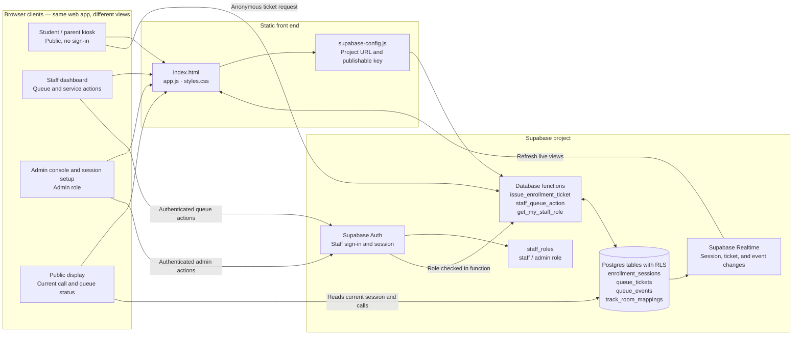
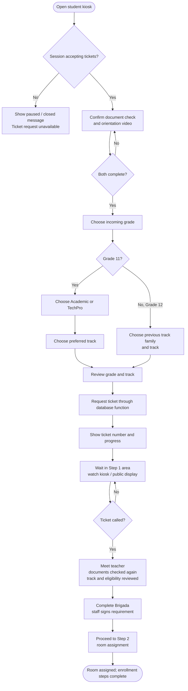
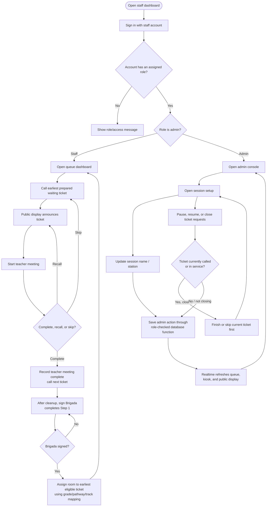

# Enrollment queue — architecture and flowcharts

This document describes the current application in the repository. The matching low-fidelity screen wireframes are in [wireframes.html](./wireframes.html).

## Main workflow represented in the app

1. **Before Step 1:** a student or parent confirms that staff checked the documents and that the student watched the orientation video.
2. **Step 1:** the student receives a queue ticket, waits for the teacher meeting, then completes Brigada sign-off. Brigada is a Step 1 sub-requirement, so Step 1 is complete only after both the teacher meeting and Brigada are done.
3. **Step 2:** staff assign a room using the student's grade, pathway, and track. The database requires Brigada sign-off and serves the earliest eligible room-assignment ticket first.

## System architecture

### Component responsibilities

| Component | Responsibility |
|---|---|
| Student / parent kiosk | Collects the prerequisite confirmations, grade, pathway, and track; requests a ticket; displays the ticket and progress. |
| Staff dashboard | Calls the next ticket, starts/completes the teacher meeting, recalls or skips a called ticket, signs Brigada, and assigns rooms. |
| Admin console | Shows session health, counts, current queue, role information, and recent activity. |
| Session setup | Changes the session/station labels and pauses, resumes, or closes ticket requests. Session changes require an administrator role. |
| Public display | Shows the active teacher-station call and connection/queue status on a shared screen. |
| Supabase Auth and `staff_roles` | Authenticates staff and distinguishes staff actions from administrator-only session controls. |
| Postgres functions and RLS | Assign shared ticket order, enforce queue transitions, protect staff actions, require Brigada before room assignment, and route the room from the configured mapping. |
| Supabase Realtime | Causes the kiosk, dashboard, and display to refresh when sessions, tickets, or queue events change. |

### Data and access boundaries

- The browser uses the Supabase project URL and publishable key from `supabase-config.js`. A service-role key does not belong in this browser app.
- Students do not sign in. The kiosk can request a ticket through the public `issue_enrollment_ticket` function. The database checks that the session is active, the required fields are present, and both preparation flags are true before assigning a shared arrival number.
- Staff sign in before queue actions. `staff_queue_action` checks for a staff role; session edits and status changes also require the administrator role.
- Browser clients do not directly insert or update queue rows. Database functions perform the writes and enforce order.
- Ticket data intentionally omits student name and ID. The public kiosk currently asks users to confirm document check and orientation; it cannot independently verify that those activities actually occurred.
- The schema supports elective-aware room mappings, but the current kiosk does not collect an elective. The current interface also represents one teacher service station.
- Staff role assignment is stored in Supabase `staff_roles`; the current Admin console displays role information but does not provide a staff-account/role editor.

## Student / parent flowchart

## Staff and admin flowchart

## Screen inventory

The wireframe file contains these screen groups:

- **Student / parent:** preparation, grade selection, Grade 11 track family, track selection (including Grade 12 previous-track mode), review, ticket/progress, and paused/closed session state.
- **Public display:** current call and empty-queue state.
- **Staff:** sign-in, queue dashboard, Brigada/room-assignment panel, and access-denied state.
- **Administrator:** admin console, session setup, password setup/expired-link state, and database connection state.

These are low-fidelity planning wireframes based on the current app. They are documentation only and do not change the live UI or deploy the app.
